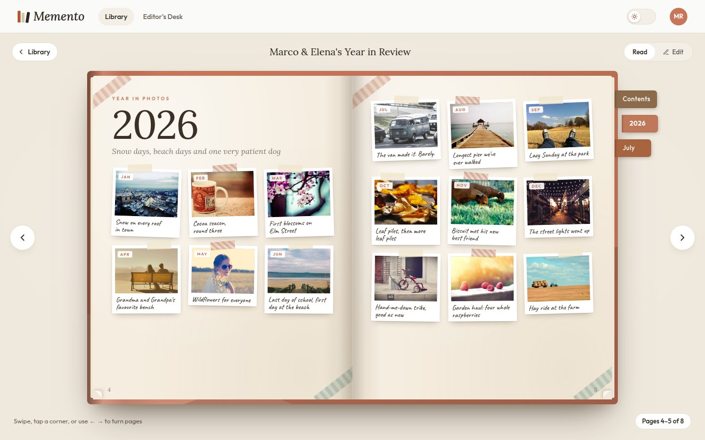

# Memento

A private, self-hosted family scrapbook. Each household's book sits on a wooden shelf, opens with a cover animation, and turns its pages in 3D. Photos are sorted into years and months, and each one gets a short handwritten-style caption from an AI model you choose.



**[Take the tour](docs/TOUR.md)** to see every screen before you install it.

## What you need

- Docker on the host that will run the app.
- A PostgreSQL server (tested with 16+).
- A MinIO server (or any S3-compatible store).
- Optional: SMTP credentials for invite and sign-in emails.
- Optional: an OpenAI-compatible chat completions endpoint for captions. You set it up in the app, not in `.env`.

## 1. Prepare Postgres

Create a database and a user for the app:

```sql
CREATE USER memento WITH PASSWORD 'choose-a-strong-password';
CREATE DATABASE memento OWNER memento;
```

Allow the Docker host to connect. Add a line like this to `pg_hba.conf`, then reload Postgres:

```
host  memento  memento  192.168.1.0/24  scram-sha-256
```

The app creates its tables on first start.

## 2. Prepare MinIO

Create an access key for the app, limited to one bucket. The app creates the `memento` bucket if it doesn't exist. Keep the bucket **private**. The app serves images through its own authenticated `/api/media` route.

Uploads work in one of two ways:

- **Default (recommended):** leave `S3_PUBLIC_ENDPOINT` empty. Browsers upload to the app, and the app writes to MinIO. MinIO never needs to be reachable from outside your LAN.
- **Direct:** set `S3_PUBLIC_ENDPOINT` to a public URL for MinIO's S3 API, for example one exposed through Pangolin. Browsers then upload straight to MinIO with presigned URLs. Add a CORS rule on the bucket that allows `PUT` from your app's origin.

## 3. Configure

```
cp .env.example .env
```

Fill in at least:

| Variable | Example |
|---|---|
| `APP_URL` | `https://memento.example.com` |
| `DATABASE_URL` | `postgres://memento:…@db.example.lan:5432/memento` |
| `S3_ENDPOINT` | `http://minio.example.lan:9000` |
| `S3_ACCESS_KEY`, `S3_SECRET_KEY` | the MinIO key from step 2 |
| `SESSION_SECRET` | `openssl rand -base64 48` |
| `ENCRYPTION_KEY` | `openssl rand -base64 32` |
| `ADMIN_EMAIL` | the super-admin's email |

Keep `ENCRYPTION_KEY` safe and unchanged. It decrypts the stored AI key. If you lose it, re-enter the AI key in the app.

Leave the `SMTP_*` values empty until you have them. Until then, sign-in and invite links are written to the container log.

## 4. Run

```
docker compose up -d --build
docker logs -f memento
```

Each start runs the database migrations and the seed, then starts the server on port 3000. Both steps are safe to repeat. The seed only fills an empty database and never overwrites your edits.

## 5. Put it behind Pangolin

Create a Pangolin resource for your domain or subdomain that points at `http://<docker-host>:3000`. Pangolin handles HTTPS. Set `TRUST_PROXY=1` (one proxy in front), or to the proxy's IP/CIDR, so the app sees real client addresses for rate limiting. Don't expose port 3000 beyond the proxy: anyone who reaches it directly can fake their address. Make sure `APP_URL` matches the public URL exactly, because email links use it.

## 6. First sign-in

1. Open the site and enter `ADMIN_EMAIL`.
2. Type the 6-digit code from the email, or tap its link. Without SMTP, the code and link are in `docker logs memento`.
3. In **Editor's Desk → Books**, set a 4-digit PIN for each book. The seeded books start locked with no PIN, so until you set one, only the admin can edit them.
4. In **Editor's Desk → AI captions**, add the endpoint URL, API key and model, then press **Test connection**.
5. In **Family members**, add emails and send invites.

The first start fills the shelf with a demo family, the Riveras: 5 households, 11 people and their books. Rename them to match your family in **Editor's Desk**, or remove the ones you don't need. Set your family name in **Settings**.

## Emails not arriving

1. Run `docker logs memento | grep Email`. The first line says whether SMTP is set up. Each email then logs `Email sent` or `Email failed`.
2. Run `docker exec memento node dist/lib/check-email.js`. It logs in to SMTP with the server's `.env` and sends a test email to `ADMIN_EMAIL`.
3. If you changed `.env`, restart with `docker compose up -d`. The container reads `.env` only when it starts.
4. With Gmail, use an app password, and check Spam and All Mail. Mail you send to yourself can skip the inbox.

## Backups

Memento keeps its data in two places, and you need both to restore it.

**Postgres** holds people, books, pages, captions and settings. Back it up nightly, for example from cron on the database host:

```
pg_dump -Fc -U memento memento > /backups/memento-$(date +%F).dump
# restore: pg_restore -c -d memento memento-YYYY-MM-DD.dump
```

**MinIO** holds the photos (`books/…` and `inbox/…`). Mirror the bucket to another disk or machine:

```
mc mirror --overwrite local/memento /backups/memento-photos
```

Also keep a copy of `.env`. Without `ENCRYPTION_KEY` the stored AI key can't be read, and without `SESSION_SECRET` everyone is signed out.

Deleted photos, books and people can be restored with Undo for 30 days. After that, an hourly job removes them and their files for good.

## Updating

```
git pull
docker compose up -d --build
```

Migrations run automatically on start.

## Development

```
pnpm install
pnpm dev        # API on :3000, web on :5173
pnpm test
pnpm typecheck
```

For local development, point `DATABASE_URL` and `S3_*` in `.env` at a dev database and bucket.

## License

MIT. See `LICENSE`.
